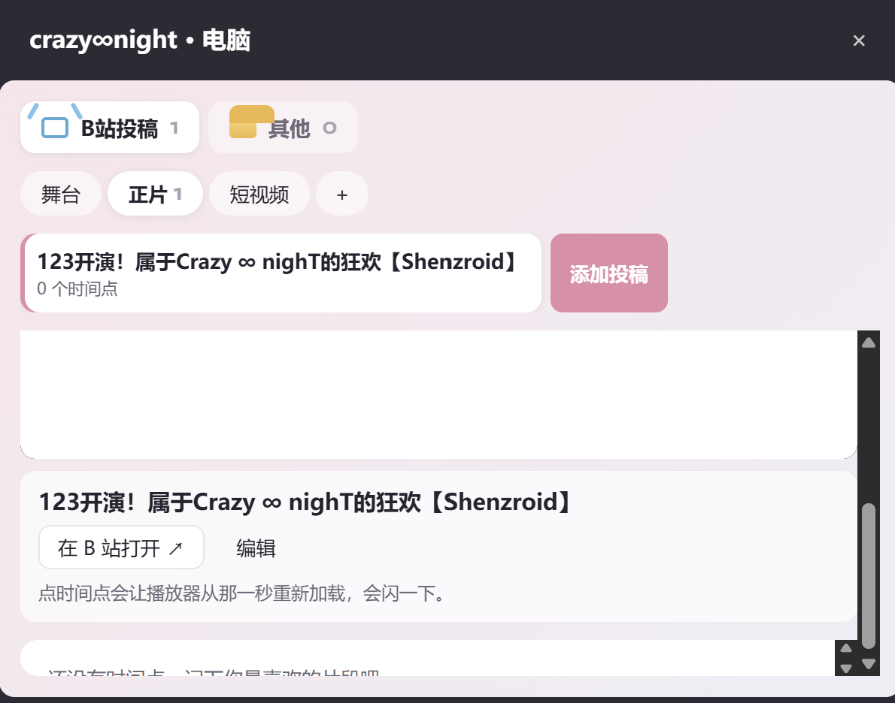

昨天学高代时来的灵感，想做一个记录宅舞活动的网页，昨晚和今早许愿把它实现得差不多了
黑色星期五啊……数分接着是无尽的程设……这周根本没怎么回过宿舍，下课就找下一间教室打开电脑开始和Claude对话
你是说这是c语言的最后一节课了？？期中考之后就要学c++了？？？我c语言基础一团糟怎么就要学c++了？？？我终于大出血买了个24h家教，你告诉我我们c语言学完了？？我的代码基础到底怎么救啊……
不过还好坚定要转专业了！！这样就可以把所有经管课翘了专心打c语言基础了……补！补！加油！
晚上是志愿者培训，背了一会议的日语。