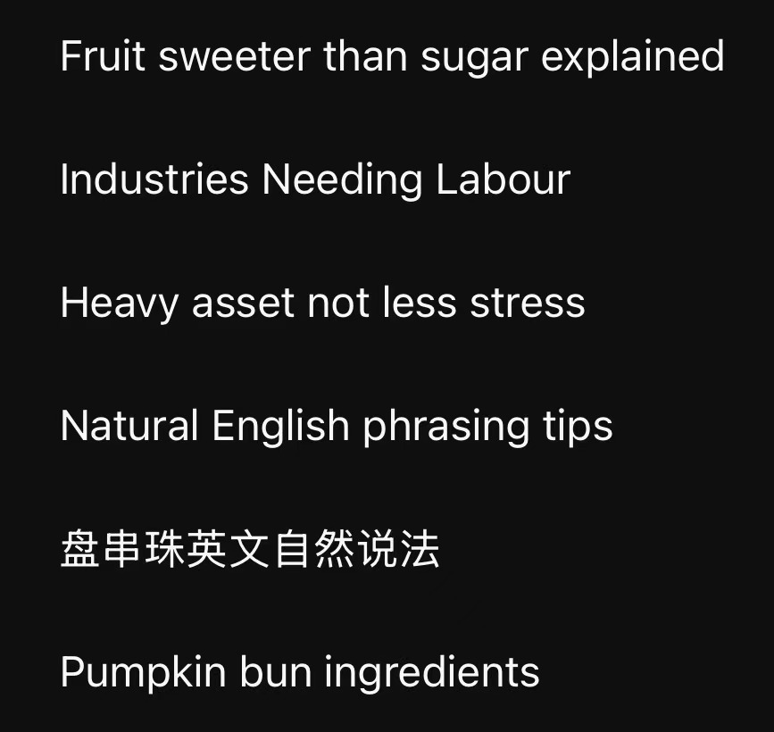

花了几乎是半天的时间在学习英语上，早上开始看油管，读x上的推，和ai全英聊天，积累生词和chunks
Trying very hard to think and speak like a native speaker...Still a long way to go...

中午路过吃了卢家妈妈的紫薯奶黄披萨、好乱卖的黑松露饼干、巷子转角的
下午去跳舞了！真开心呀！晚上写了会儿数分去听宝洁宣讲了，不愧是我从高中就开始关注的梦司……好幸福……认识了很好的朋友！学长的分享也很有帮助，果然对口项目经历还是大于一切吧！大学还是多积累经历，多从项目里学习！
继续干我喜欢的项目吧！！！